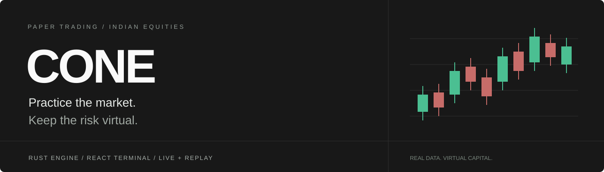
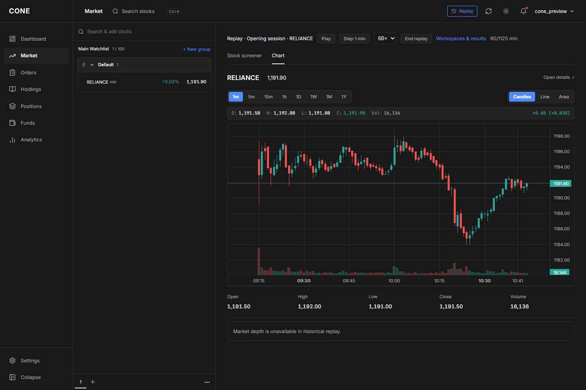
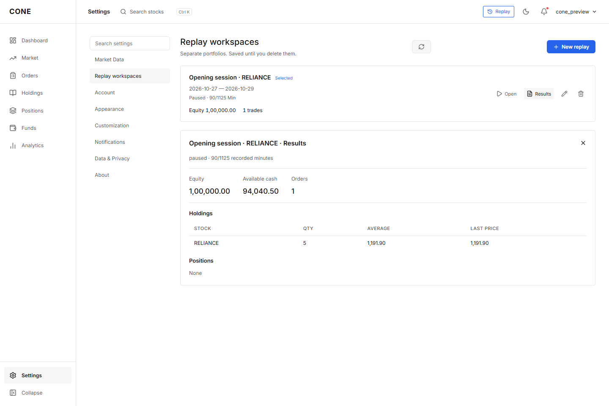
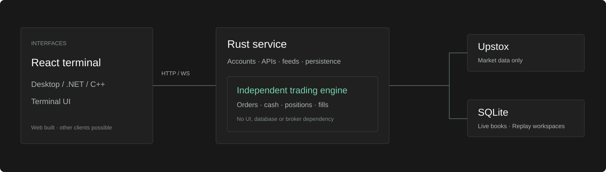

<p align="center">
  
</p>

<p align="center">
  
  
  
  
</p>

<p align="center">
  An Indian-equities paper trading terminal.<br>
  Real market data. Virtual money. A reusable Rust engine.
</p>

<p align="center">
  <a href="#start-locally">Get started</a> ·
  <a href="docs/market-modes.md">Live &amp; Replay</a> ·
  <a href="docs/engine.md">Engine guide</a> ·
  <a href="docs/api.md">API</a>
</p>

## The terminal



| Follow the market | Practice your decisions | Make it yours |
| :--- | :--- | :--- |
| Watchlists, groups & stock search | Quick & Regular order tickets | Day, Night & Charcoal themes |
| Candles, volume & live depth | Market, limit & stop orders | Show or hide market panels |
| CNC holdings & MIS positions | Virtual cash, P&L & order history | Drag, pin & organize stocks |

## Two ways to practice

| **Live** | **Replay workspaces** |
| :--- | :--- |
| Upstox streams current market data. | Choose a name, stocks and past date range. |
| Record only what this installation receives. | Play real minute candles; skip closed hours. |
| Keep recordings across restarts, with gaps intact. | Separate portfolios, saved results, resumable progress. |
| All orders use virtual money. | Rename, extend or delete each workspace. |



Replay uses historical **one-minute candles**, not reconstructed ticks or invented depth. Live charts have no historical backfill. [How the modes work →](docs/market-modes.md)

## One engine, different interfaces



The React terminal uses HTTP/WebSocket. Future desktop or TUI clients can use the same service. The standalone [Rust engine](backend/engine/README.md) owns trading rules and integer money calculations; direct use from another language requires bindings.

## Start locally

Install **Rust stable** with native build tools and **Node.js 22.12+**.

```sh
git clone https://github.com/arunmauryaz/cone-paper-trading.git
cd cone-paper-trading
cargo run --manifest-path backend/Cargo.toml -p cone-backend --locked
```

In a second terminal:

```sh
cd cone-paper-trading/frontend
npm ci
npm run dev
```

Open **http://localhost:5173**, register an account, then add your Upstox token in **Settings → Market Data**. Create practice sessions in **Settings → Replay workspaces**.

**Windows shortcut:** `launcher.bat` starts both services. It restarts listeners on ports **8000 and 5173**. Account data, broker tokens and recordings stay in the ignored `data/` folder.

## Explore the project

| Folder | Guide |
| :--- | :--- |
| `backend/engine/` · independent trading library | [Rules & reuse](docs/engine.md) |
| `backend/src/` · accounts, APIs, feeds, persistence | [Backend](docs/backend.md) · [API](docs/api.md) |
| `frontend/` · React terminal | [Interface](docs/frontend.md) |
| `docs/` · setup, behavior & checks | [Development](docs/development.md) · [Verification](docs/verification.md) |

**Status:** working local/single-process application; public multi-user scaling is unbenchmarked. Paper trading only—no real broker orders. Full exchange settlement, taxes and liquidity behavior are outside the current scope.
